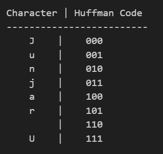

# Ex 11: Huffman-Coding

### Name:  Junjar U
### Reg No: 212224230110

## Aim
To implement Huffman coding to compress the data using Python.

Software Required
Anaconda - Python 3.7

Algorithm:
Step 1: Take the input string from the user. Step 2: Calculate the frequency of each character in the string. Step 3: Build the Huffman Tree using a priority queue based on frequencies. Step 4: Traverse the tree to assign binary codes to characters. Step 5: Display the Huffman code for each character.

## Program:
```py
## Get the input String
string = 'Junjar U'

class NodeTree(object):
    def __init__(self, left=None, right=None): 
        self.left = left
        self.right=right
    def children(self):
        return (self.left,self.right)
    def nodes (self):
        return (self.left,self.right)
    def __str__(self):
        return '%s %s' %(self.left,self.right)
```
```py
## Create tree nodes
def huffman_code_tree (node, left=True, binString=''):
    if type(node) is str:
        return {node: binString}
    (l, r) = node.children()
    d = dict()
    d.update(huffman_code_tree (l, True, binString + '0'))
    d.update(huffman_code_tree (r, False, binString + '1'))
    return d
```
```py
## Main function to implement huffman coding
freq = {}
for c in string:
    if c in freq:
        freq[c] += 1
    else:
        freq[c] = 1
freq = sorted(freq.items(), key=lambda x: x[1], reverse=True)
nodes = freq
```
```py
## Calculate frequency of occurrence
while len(nodes) > 1:
    (key1, c1) = nodes[-1]
    (key2, c2) = nodes[-2]
    nodes = nodes[:-2]
    node = NodeTree(key1, key2)
    nodes.append((node, c1 + c2))
    nodes = sorted(nodes, key=lambda x: x[1], reverse=True)
```
```py
## Print the characters and its huffmancode
huffmanCode = huffman_code_tree(nodes[0][0])
print(' Char | Huffman code ') 
print('----------------------')
for (char, frequency) in freq:
    print('%-4r|%12s' % (char, huffmanCode[char]))
```
# Output:



## Result
Thus the huffman coding was implemented to compress the data using python programming.
